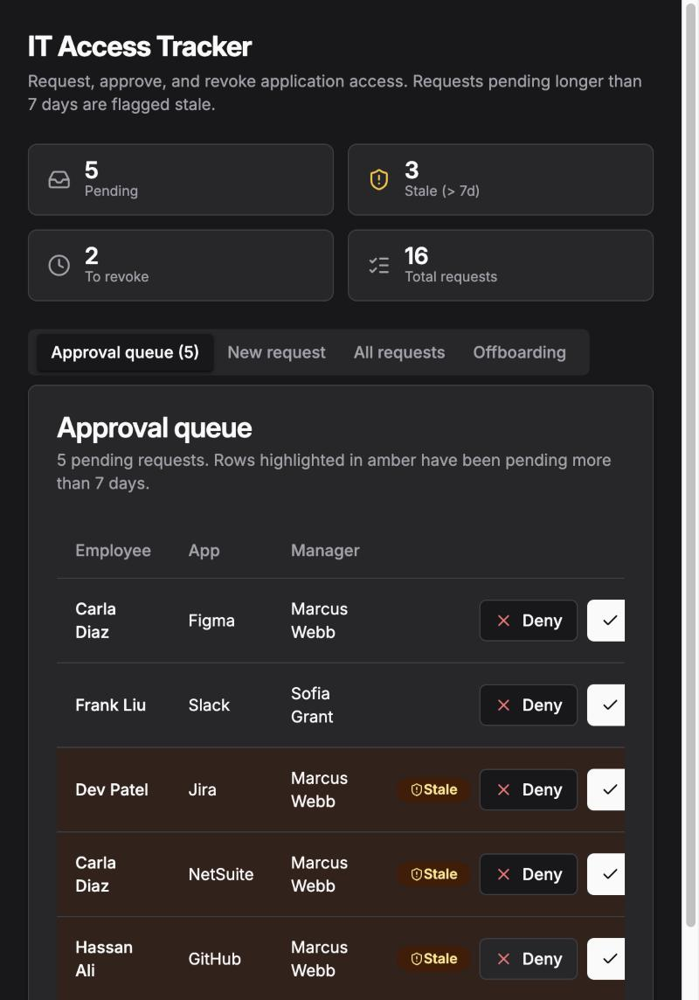
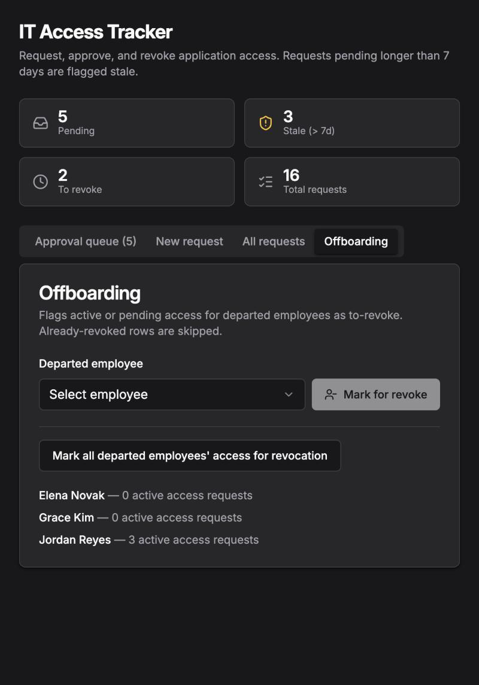

# IT Access Request & Offboarding Tracker (Retool Prototype)

A small internal tool for the access-request lifecycle: employees request access to an app, a manager approves or denies it, requests that sit too long get flagged, and when someone leaves, their remaining access gets marked for revocation.

**All data is fictional.** Employees, apps and requests are made-up sample data in Retool Database. Nothing here touches a real identity provider.

**Live app:** https://buildwithyee--it-access-tracker.retool.app (hosted on Retool, so it may go offline; the screenshots below are the permanent record)

## Screenshots

| Approval queue | Offboarding |
|---|---|
|  |  |

## What it does

- **New request tab:** form with employee, app, reason and manager. Selecting an employee auto-fills their manager. Submitting inserts a `pending` row.
- **Approval queue:** pending requests with Approve / Deny buttons that update the status in the database.
- **Stale flag:** pending requests older than 7 days are highlighted and badged "Stale". The header shows live counts (pending, stale, to-revoke, total).
- **All requests tab:** full history with status badges (pending, approved, denied, to-revoke).
- **Offboarding tab:** lists departed employees with how many active (pending or approved) requests each still has. "Mark for revoke" flags one employee's access as `to-revoke`; a bulk button does it for every departed employee. Rows already revoked are skipped.

The seed data deliberately includes a departed employee (Jordan Reyes) who still holds three approved grants (GitHub, Salesforce, Slack), so the offboarding tab has something real to find. The same idea as the fixtures in my other audit tools: a check that returns nothing proves nothing.

## How it's built

- Generated with Retool's AI app builder (beta), then reviewed and tested by clicking through every feature.
- Data lives in Retool Database (PostgreSQL): `employees`, `apps`, `access_requests`.
- Backend functions (TypeScript) handle the writes: create a request, update a status (validated against an allowed list), mark departed employees' access for revoke.
- A separate **Retool Workflow** ("Offboarding - mark departed user access to-revoke") runs the same revoke SQL. It is published but has **no trigger enabled**, so it does not run on a schedule.

## Limitations

- Prototype only. No authentication or role checks: anyone with the link can approve a request.
- "Mark for revoke" only sets a status. Nothing actually removes access in any real system.
- The Okta integration I considered is **not** built. This app does not call Okta or any external API.
- The Workflow still contains Retool's default sample code block from its template.
- The in-app offboarding action and the Workflow are separate implementations of the same SQL, not one calling the other.
